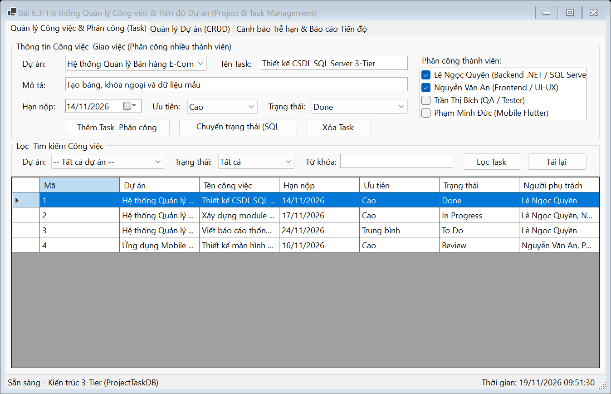
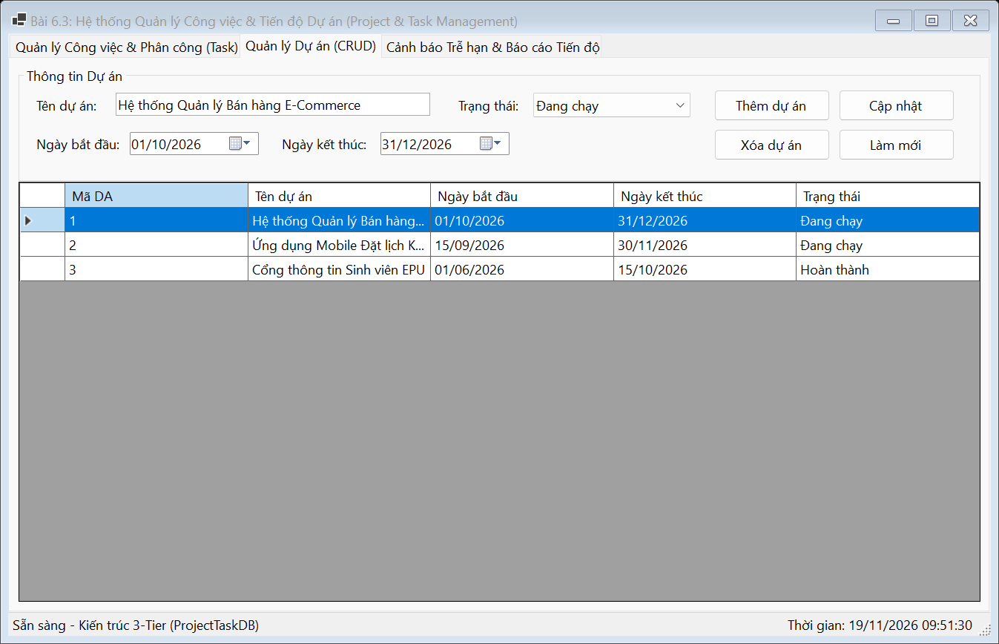
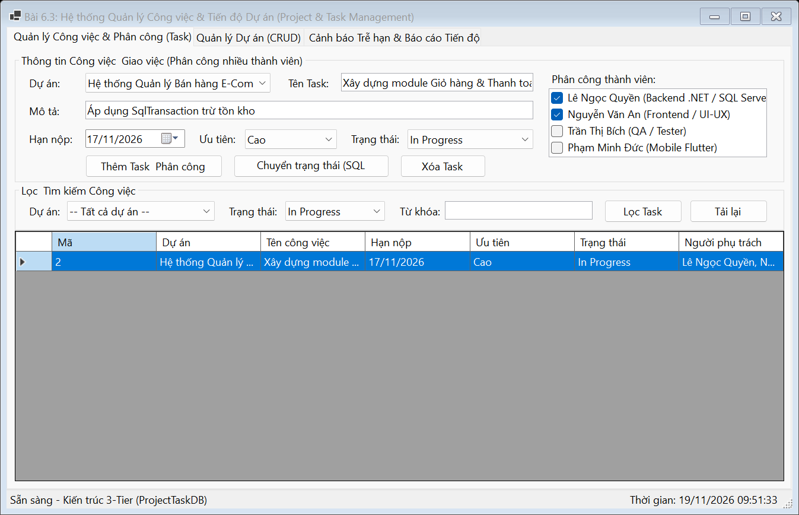
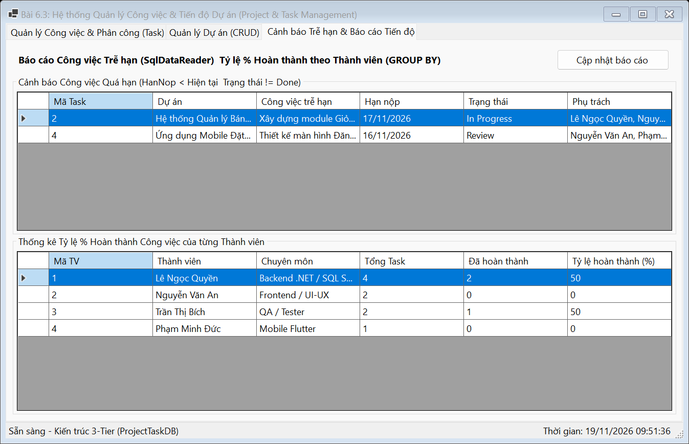
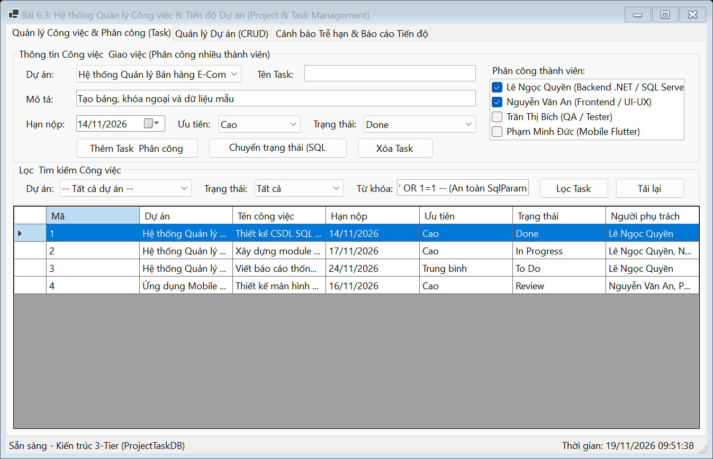

# BÀI 6.3: HỆ THỐNG QUẢN LÝ CÔNG VIỆC & TIẾN ĐỘ DỰ ÁN (PROJECT & TASK MANAGEMENT)

## MỤC 1: THÔNG TIN SINH VIÊN
- **Họ và tên sinh viên:** Lê Ngọc Quyền
- **Mã sinh viên:** 24810310259
- **Lớp / Khóa:** D19CNPM3
- **Môn học:** Lập trình .NET / Windows Forms (ADO.NET & Kiến trúc 3-Tier)

---

## MÔ TẢ KIẾN TRÚC & TÍNH NĂNG
- **Kiến trúc chuẩn 3-Tier:** `DTO` $\rightarrow$ `DAL` $\rightarrow$ `BUS` $\rightarrow$ `GUI`.
- **CSDL SQL Server (`ProjectTaskDB`):** Gồm 4 bảng (`DuAn`, `ThanhVien`, `CongViec`, `PhanCong`) trong [`Database/ScriptDB.sql`](./Database/ScriptDB.sql).
- **Quản lý Dự án & Task:** Thêm, sửa, xóa dự án; tạo công việc con và phân công đồng thời cho nhiều thành viên (`PhanCong` qua `SqlTransaction`).
- **Cập nhật Tiến độ:** Lọc Task theo Dự án, Trạng thái (*To Do*, *In Progress*, *Review*, *Done*) và từ khóa; chuyển trạng thái công việc bằng Parameterized SQL Update.
- **Cảnh báo Trễ hạn & Báo cáo:** Dùng `SqlDataReader` liệt kê các công việc quá hạn (`HanNop < GETDATE()` và `TrangThai != 'Done'`) và thống kê tỷ lệ `%` hoàn thành của từng thành viên bằng `GROUP BY`.

---

## MỤC 2: HÌNH ẢNH KẾT QUẢ CÁC MÀN HÌNH CHỨC NĂNG

### 1. Màn hình Chính / Tổng quan hệ thống

### 2. Màn hình Quản lý Danh mục (CRUD Dự án)

### 3. Màn hình Thực thi Nghiệp vụ chính (Lọc & Chuyển trạng thái Công việc)

### 4. Màn hình Báo cáo - Thống kê (Cảnh báo Trễ hạn & Tỷ lệ % Hoàn thành)

### 5. Minh họa An toàn Dữ liệu (Phòng chống SQL Injection / Kiểm tra hợp lệ)

