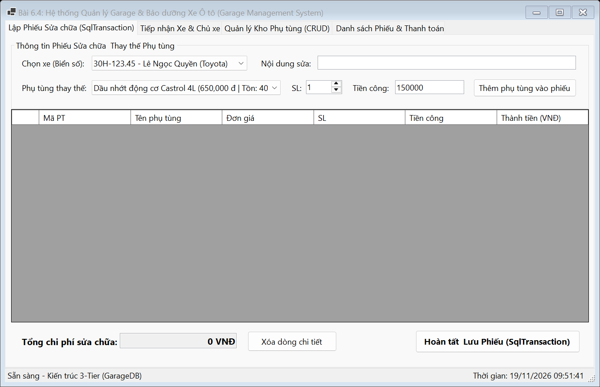
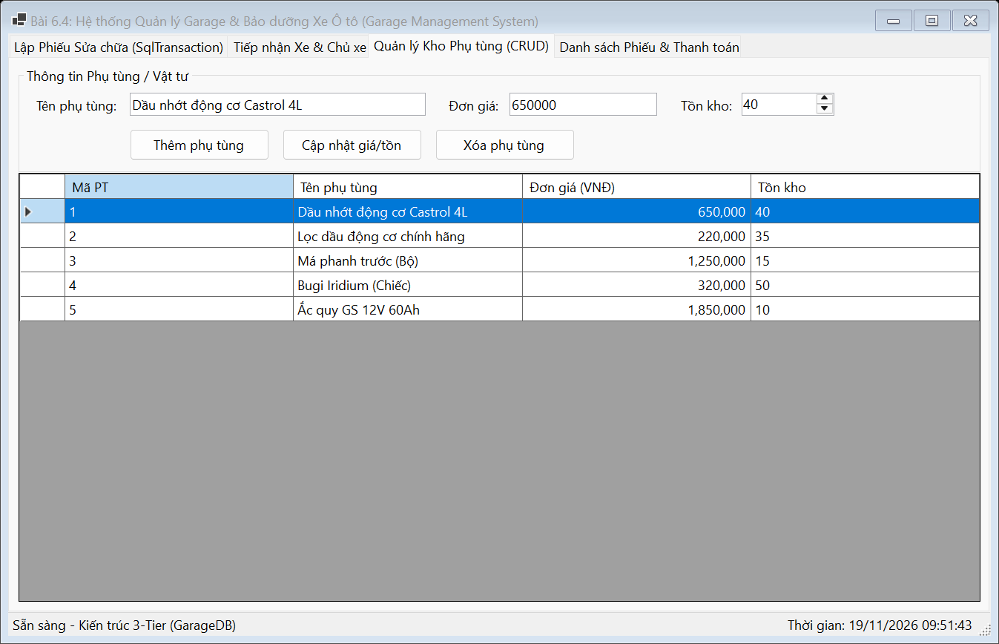
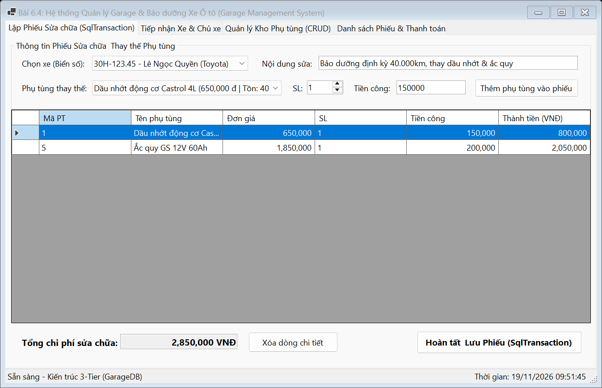
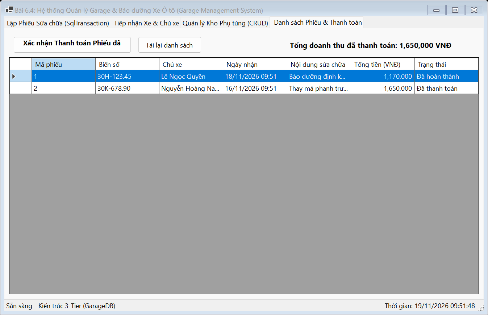
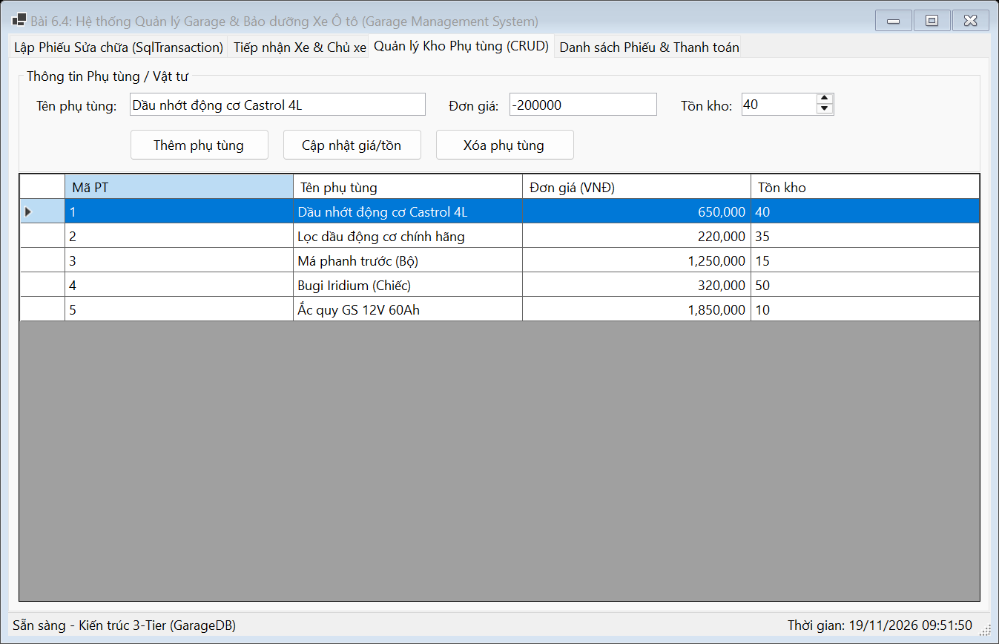

# BÀI 6.4: HỆ THỐNG QUẢN LÝ GARAGE & BẢO DƯỠNG XE Ô TÔ (GARAGE MANAGEMENT SYSTEM)

## MỤC 1: THÔNG TIN SINH VIÊN
- **Họ và tên sinh viên:** Lê Ngọc Quyền
- **Mã sinh viên:** 24810310259
- **Lớp / Khóa:** D19CNPM3
- **Môn học:** Lập trình .NET / Windows Forms (ADO.NET & Kiến trúc 3-Tier)

---

## MÔ TẢ KIẾN TRÚC & TÍNH NĂNG
- **Kiến trúc chuẩn 3-Tier:** `DTO` $\rightarrow$ `DAL` $\rightarrow$ `BUS` $\rightarrow$ `GUI`.
- **CSDL SQL Server (`GarageDB`):** Gồm 5 bảng (`KhachHang`, `Xe`, `PhuTung`, `PhieuSuaChua`, `ChiTietSuaChua`) trong [`Database/ScriptDB.sql`](./Database/ScriptDB.sql).
- **Tiếp nhận Xe & Quản lý Kho Phụ tùng:** Tra cứu biển số xe bằng `SqlParameter`; tiếp nhận xe mới & chủ xe; CRUD phụ tùng cập nhật đơn giá và tồn kho.
- **Lập Phiếu Sửa chữa (`SqlTransaction`):** Chèn `PhieuSuaChua`, chèn `ChiTietSuaChua`, tự động trừ `PhuTung.SoLuongTon -= SoLuong`; nếu không đủ tồn kho lập tức `trans.Rollback()` và báo lỗi.
- **Thanh toán & Xuất Hóa đơn:** Tự động tính `TongTien = SUM(SoLuong * DonGia) + SUM(TienCong)` và chuyển trạng thái phiếu sang *"Đã thanh toán"*.

---

## MỤC 2: HÌNH ẢNH KẾT QUẢ CÁC MÀN HÌNH CHỨC NĂNG

### 1. Màn hình Chính / Tổng quan hệ thống

### 2. Màn hình Quản lý Danh mục (CRUD Kho Phụ tùng)

### 3. Màn hình Thực thi Nghiệp vụ chính (Lập Phiếu Sửa chữa với SqlTransaction)

### 4. Màn hình Báo cáo - Thống kê (Danh sách Phiếu & Thanh toán)

### 5. Minh họa An toàn Dữ liệu (Kiểm tra hợp lệ & Xử lý lỗi Transaction)

