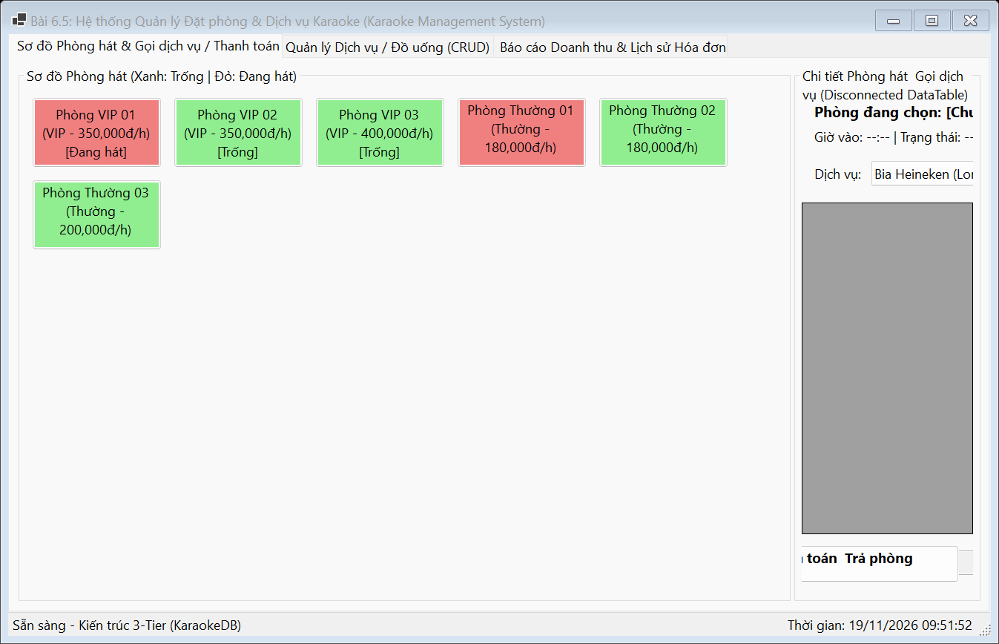
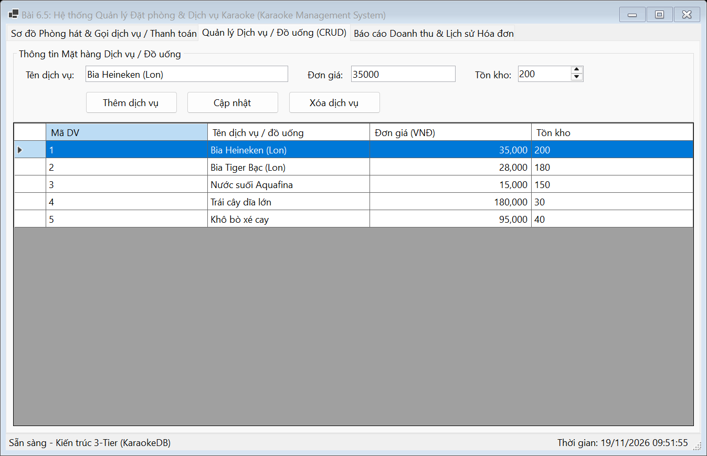
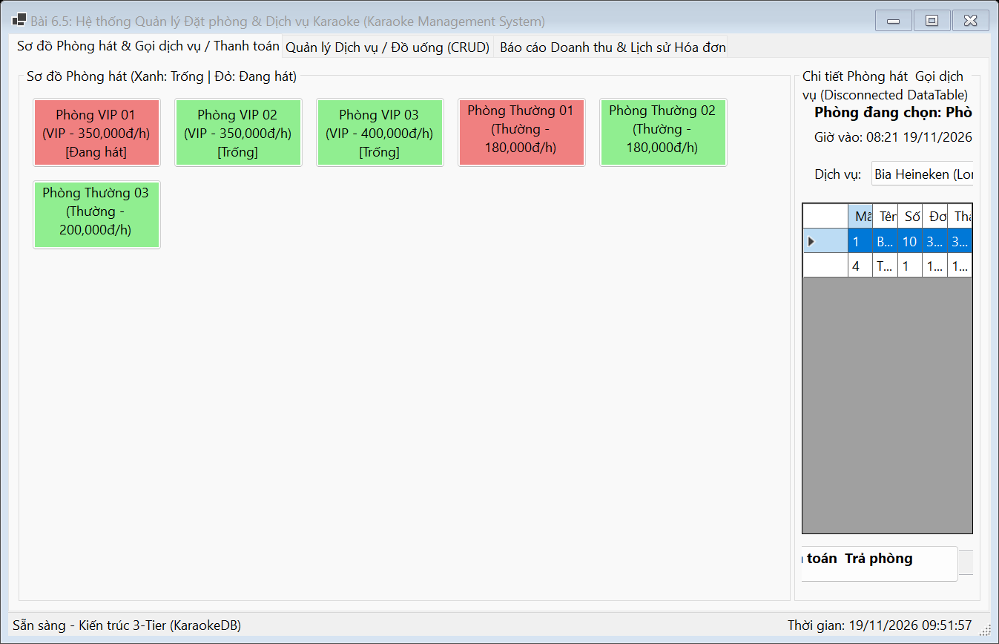
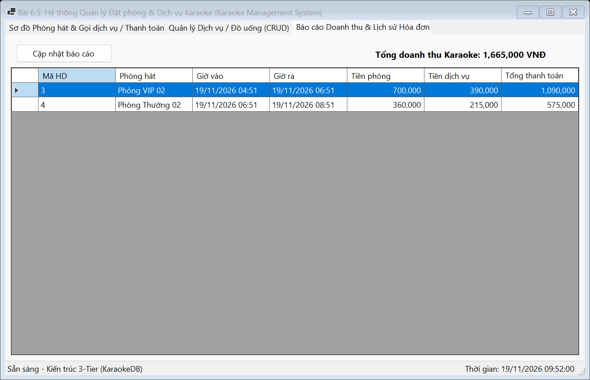
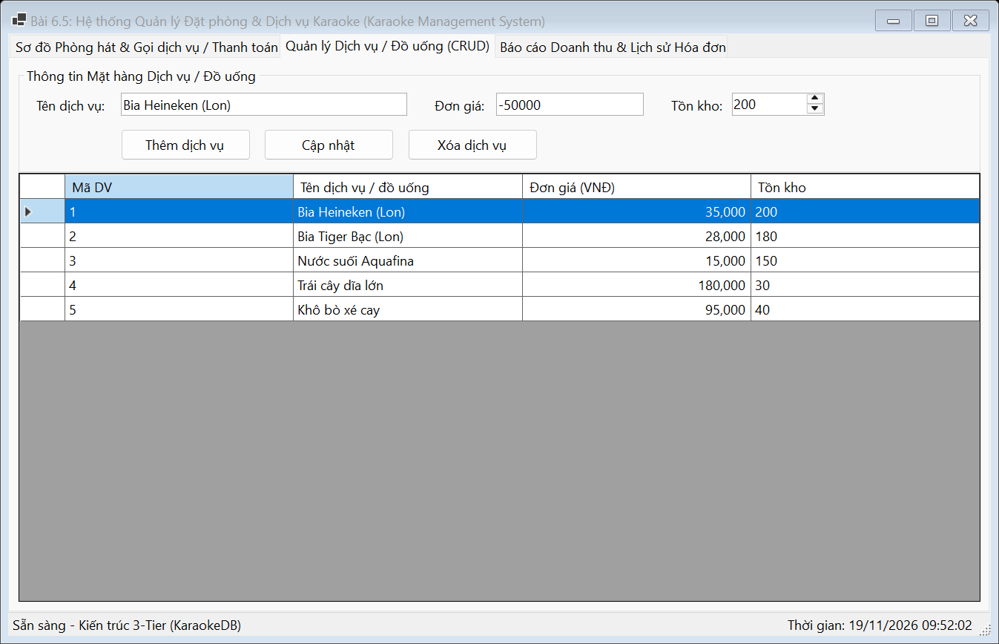

# BÀI 6.5: HỆ THỐNG QUẢN LÝ ĐẶT PHÒNG & DỊCH VỤ KARAOKE (KARAOKE MANAGEMENT SYSTEM)

## MỤC 1: THÔNG TIN SINH VIÊN
- **Họ và tên sinh viên:** Lê Ngọc Quyền
- **Mã sinh viên:** 24810310259
- **Lớp / Khóa:** D19CNPM3
- **Môn học:** Lập trình .NET / Windows Forms (ADO.NET, Disconnected Model & Kiến trúc 3-Tier)

---

## MÔ TẢ KIẾN TRÚC & TÍNH NĂNG
- **Kiến trúc chuẩn 3-Tier:** `DTO` $\rightarrow$ `DAL` $\rightarrow$ `BUS` $\rightarrow$ `GUI`.
- **CSDL SQL Server (`KaraokeDB`):** Gồm 4 bảng (`PhongHat`, `DichVu`, `HoaDon`, `ChiTietDichVu`) trong [`Database/ScriptDB.sql`](./Database/ScriptDB.sql).
- **Sơ đồ Phòng hát trực quan (Visual Room Grid):** Hiển thị các phòng hát dạng nút bấm động (`FlowLayoutPanel`), phòng *Trống* màu xanh, phòng *Đang hát* màu đỏ; bấm *Mở phòng* ghi nhận `GioVao = GETDATE()`.
- **Gọi Dịch vụ / Đồ uống (Disconnected Model):** Nạp danh sách dịch vụ đã gọi của phòng bằng `SqlDataAdapter` + `DataTable` lên `DataGridView`.
- **Tính Tiền & Thanh toán (`SqlTransaction`):** Tự động tính thời gian hát (`GioRa - GioVao`), tính `TongTienPhong = Số giờ * GiaTheoGio`, cập nhật `HoaDon`, trừ `DichVu.TonKho` (Rollback nếu thiếu tồn kho), và trả `PhongHat` về trạng thái *"Trống"*.

---

## MỤC 2: HÌNH ẢNH KẾT QUẢ CÁC MÀN HÌNH CHỨC NĂNG

### 1. Màn hình Chính / Tổng quan hệ thống (Sơ đồ Phòng hát)

### 2. Màn hình Quản lý Danh mục (CRUD Dịch vụ / Đồ uống)

### 3. Màn hình Thực thi Nghiệp vụ chính (Gọi Dịch vụ DataTable & Thanh toán SqlTransaction)

### 4. Màn hình Báo cáo - Thống kê (Doanh thu & Lịch sử Hóa đơn)

### 5. Minh họa An toàn Dữ liệu (Kiểm tra lỗi đầu vào & Transaction Rollback)

